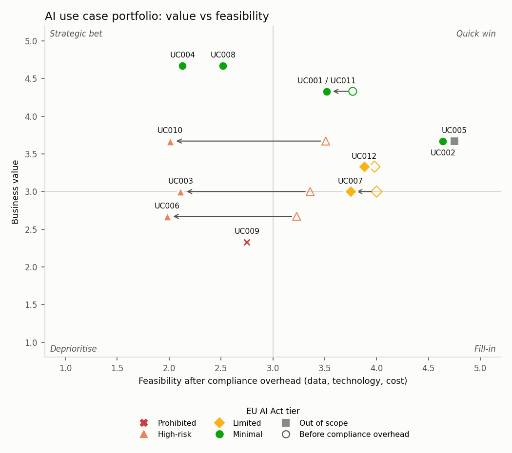

# AI Use Case Assessment under the EU AI Act

## What this project does

This project helps a team decide which data and AI ideas are worth building. It also shows what each idea needs before it can go live under the **EU AI Act** and the **GDPR**.

Every idea is scored on business value and feasibility. It is also checked for regulatory risk:

- **EU AI Act risk tier:** prohibited, high-risk, limited, minimal, or out of scope (Regulation (EU) 2024/1689).
- **GDPR DPIA check:** whether a Data Protection Impact Assessment is needed (Art. 35).
- **Obligations:** what has to be done, with article references.
- **Gate decision:** Go, Go with conditions, Stop, or Assess first.

Compliance work costs time and money, so it lowers an idea's feasibility. A high-value idea can turn out to be a slow strategic bet once its obligations are counted. A prohibited idea is stopped, however good its score.



In the demo data, the **Resume Screening Assistant** shows why this matters. On business score alone it ranks as Medium priority. AI used for recruitment is high-risk under the AI Act (Annex III(4)), and it needs a DPIA. Once that work is counted, its score falls from 3.23 to 2.42.

**Call Centre Emotion Monitoring** is stopped. Emotion recognition in the workplace is a prohibited practice under Art. 5(1)(f).

## How it works

1. **`data/use_cases.csv`** holds one row per idea, with 1 to 5 scores for business impact, data availability, technical feasibility, and cost and effort. For cost and time, 5 means cheap or fast.
2. **`data/risk_profile.csv`** holds the risk questionnaire for each idea. All answers are yes/no or a short code. They cover:
   - who builds the system (provider) or buys it (deployer)
   - whether it is an AI system at all
   - prohibited practices and Annex III areas
   - profiling of people, chatbots and generated content
   - personal and sensitive data, monitoring, large-scale processing, vulnerable people
3. **`scoring.py`** turns the sub scores into four category scores and a weighted final score.
4. **`ai_act.py`** assigns the risk tier and lists the obligations:
   - Prohibited practices (Art. 5).
   - High-risk through Annex I products (Art. 6(1)) or Annex III areas (Art. 6(2)), including the Art. 6(3) exception. The exception never applies when the system profiles people.
   - Transparency duties (Art. 50).
   - AI literacy (Art. 4).
   - The fundamental rights impact assessment (FRIA, Art. 27) where it applies.
   - Different duties for providers and deployers.
5. **`gdpr.py`** checks the Art. 35(3) cases and the EDPB criteria for a DPIA. Two or more criteria means a DPIA is required. It also flags Art. 22 when people are subject to automated decisions.
6. **`portfolio.py`** subtracts a compliance overhead from feasibility, places each idea in a quadrant, decides the gate and ranks the portfolio.
7. **`report.py`** writes the matrix, the Excel workbook and the steering one-pager.

## Outputs

| File | Contents |
|---|---|
| `output/AI_Use_Case_Portfolio.xlsx` | **Portfolio:** ranked list with scores, tier, DPIA, gate and conditions. **Matrix:** the chart. **Obligations:** one row per obligation, with Status and Owner columns to track it. **Method:** weights and assumptions. |
| `output/steering_one_pager.pdf` | One A4 page for a steering committee: matrix, ranked table and the compliance actions needed before go-live |
| `output/portfolio_matrix.png` | Value vs feasibility matrix. Hollow markers show where an idea sat before compliance overhead. |
| `output/prioritized_report.csv` | The ranked portfolio as CSV |

## How to run it

```
pip install -r requirements.txt
python main.py
python -m pytest -q        # 25 tests
```

## How to use it with your own ideas

Add a row to `data/use_cases.csv` and a matching row to `data/risk_profile.csv`, then run the script again. The allowed codes for `prohibited_practice` and `annex_iii_area` are listed in `ai_act.py`. An unknown code stops the run with an error. An idea without a risk profile gets the gate **Assess first**.

## Scoring

| Category | Weight |
|---|---|
| Business impact (value) | 35% |
| Data availability | 25% |
| Technical feasibility | 25% |
| Cost and effort | 15% |

Feasibility is the weighted average of the last three categories. Compliance overhead is subtracted from feasibility, in points on the 1 to 5 scale:

| Situation | Overhead |
|---|---|
| High-risk, provider (conformity assessment, QMS, technical documentation) | 1.0 |
| High-risk, deployer | 0.5 |
| Limited risk, provider / deployer | 0.25 / 0.1 |
| DPIA required | +0.25 |
| FRIA required | +0.25 |

The adjusted score is 35% value plus 65% adjusted feasibility. This is the original formula, with feasibility measured after compliance overhead.

The weights and overheads are planning assumptions. Change them in `scoring.py` and `portfolio.py` to fit your organisation.

## Limitations

- This is a screening tool. It helps structure the conversation with legal and data protection teams. It is not legal advice.
- The classification is only as good as the questionnaire answers.
- The EU AI Act applies in stages, and its implementation timeline may change. Check the current application dates for each obligation.
